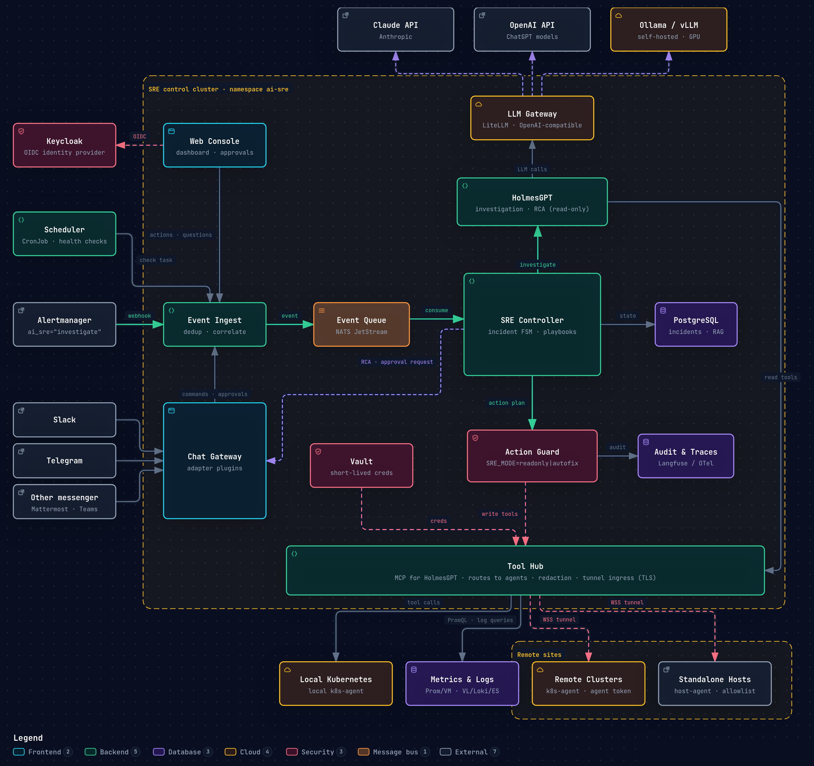
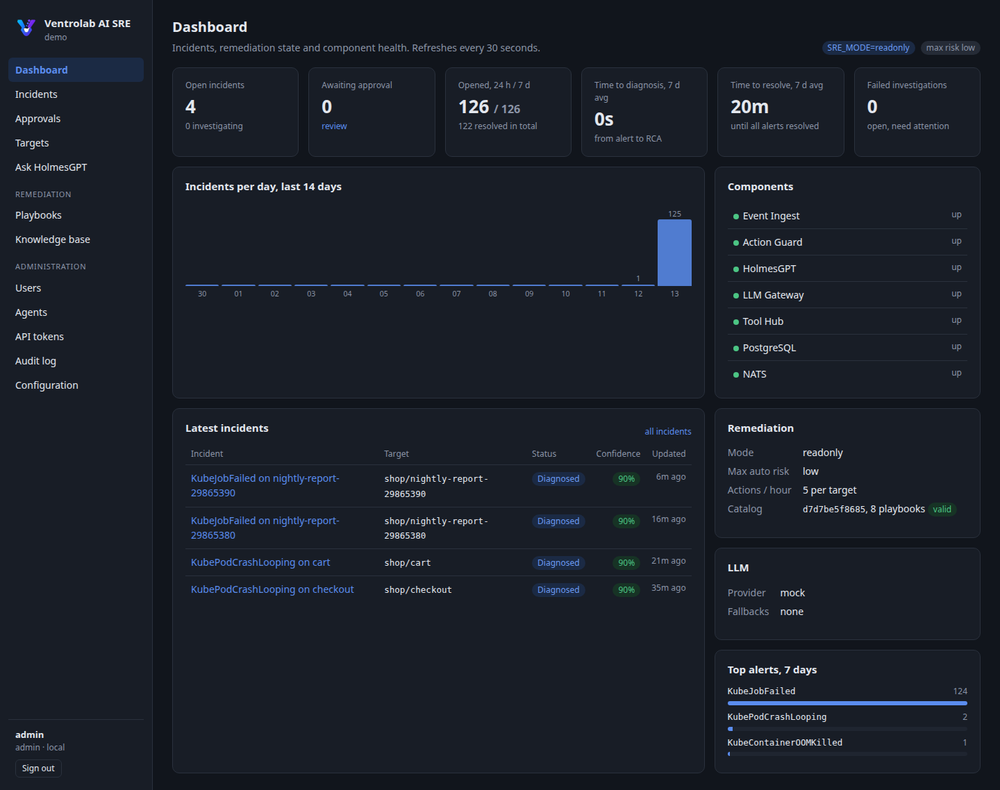

<p align="center">
  <picture>
    <source media="(prefers-color-scheme: dark)" srcset="docs/assets/ventrolab-logo-dark.png">
    
  </picture>
</p>

# Ventrolab AI SRE

Kubernetes-native AI SRE system: alert investigation with HolmesGPT, guarded autofix, multi-cluster and host reach, pluggable LLM (Claude, OpenAI, self-hosted) and pluggable messengers.

- Architecture: [ARCHITECTURE.md](ARCHITECTURE.md)
- Interactive diagram: [docs/architecture.html](docs/architecture.html) (source: `docs/architecture.json`, built with archify)



## Quick start

Try it on a local kind cluster: monitoring, Ventrolab AI SRE and three broken workloads,
investigated within a few minutes. Needs Docker (8 GB RAM), kind, helm, kubectl and an
Anthropic or OpenAI API key.

```
git clone https://github.com/ventrolab/ai-sre.git && cd ai-sre
export ANTHROPIC_API_KEY=...        # or: export OPENAI_API_KEY=... LLM_PROVIDER=openai
make demo                           # prints the console URL and the admin password
make -C deploy/demo status          # incidents and their root causes
make -C deploy/demo clean
```

Details: [deploy/demo/README.md](deploy/demo/README.md). Production setup: the Helm chart
`oci://ghcr.io/ventrolab/ai-sre/charts/ai-sre` and [docs/alerting.md](docs/alerting.md).

## How it works

1. Alertmanager (or a scheduled check, or a chat message) sends an event to **Event Ingest**,
   which correlates alerts about the same object into one incident and puts it on NATS.
2. **SRE Controller** opens the incident and asks **HolmesGPT** to investigate. Holmes
   picks the matching skills from the knowledge base, then reads metrics, logs, events
   and specs with read-only tools, through the **LLM Gateway** (Claude, OpenAI or a
   self-hosted model).
3. The RCA comes back with a structured verdict (root cause, confidence, playbook).
4. If a playbook fits, **Action Guard** decides by `SRE_MODE`, risk class and limits:
   propose only, ask for approval in chat, or execute.
5. **Chat Gateway** posts the RCA, proposals and approval requests to Telegram (or another
   messenger) and accepts commands back. Approvals are decided in the web console
   (Approve/Reject buttons in chat are an enterprise feature).

Not every alert needs an investigation: route only the alerts where the cause has to be
found (latency, full disks, CPU load, storage out of sync) to AI SRE with an opt-in label
and keep the direct receivers for everything else. See
[docs/alerting.md](docs/alerting.md).

## Web console



`services/web`: dashboard (open incidents, time to diagnosis and resolution,
incidents per day, top alerts, remediation mode, LLM, component health),
incidents with RCA, alerts and timeline, approvals, ad-hoc questions to HolmesGPT,
the playbook catalog with its YAML, the knowledge base, users, audit log and the
effective configuration.

| Role | Can |
|---|---|
| viewer | read everything except administration |
| operator | approve or reject actions, rerun investigations, ask HolmesGPT |
| admin | manage local users, see the audit log and configuration |

Sign-in: local accounts (bcrypt, first admin generated into Secret `<release>-web`)
and OIDC (tested with Keycloak). Roles of SSO users come from identity provider groups
(`web.auth.oidc.roleMapping`); users without a mapped group are denied unless
`defaultRole` is set. `web.auth.local.enabled=false` switches to SSO only.
Approvals and reinvestigations from the console go through ingest, the same path as
chat commands.

## Layout

| Path | Contents |
|---|---|
| `charts/ai-sre` | Helm chart for the control plane |
| `libs/python/aisre-common` | Shared Python models (events, notifications) and NATS helpers |
| `deploy/demo` | Local demo and development environment on kind: monitoring, alerting, broken workloads |
| `charts/k8s-agent` | Helm chart for remote clusters |
| `services/ingest` | Event Ingest |
| `services/controller` | SRE Controller (incident lifecycle, playbooks) |
| `services/action-guard` | Action Guard (`SRE_MODE`, risk, approvals) |
| `services/tool-hub` | Tool Hub (MCP registry and routing) |
| `services/chat-gateway` | Chat Gateway and messenger adapters |
| `services/web` | Web console (FastAPI, server-rendered pages, htmx) |
| `agents/k8s-agent` | Agent for remote Kubernetes clusters |
| `agents/host-agent` | Agent for standalone hosts |
| `cli/aisre` | Terminal client: status, incidents, approvals, agents (linux/darwin, amd64/arm64) |
| `mcp-servers/*` | MCP servers: kubernetes, prometheus, logs (Loki, VictoriaLogs, Elasticsearch/OpenSearch), host |
| `playbooks` | Remediation playbook catalog with risk classes |
| `skills` | Knowledge base: troubleshooting skills for HolmesGPT |
| `docs` | Alerting setup, development guide, decision log, releasing, images |
| `scripts` | Helpers: chat commands, incidents, Holmes and LLM checks, console screenshots |
| `policies` | Scope and mode policies |
| `evals` | Incident replay scenarios for LLM evaluation |

## Key settings

| Variable | Values | Default |
|---|---|---|
| `SRE_MODE` | `readonly`, `autofix` | `readonly` |
| `LLM_PROVIDER` | `claude`, `openai`, `ollama` | `claude` |
| `CHAT_ADAPTERS` | `slack`, `telegram`, ... | `telegram` |

Full list: ARCHITECTURE.md, section 6.

## Status

Phases 1 (foundation), 2 (Tool Hub, agents) and 3 (remediation executor) are implemented:

| Component | State |
|---|---|
| Event Ingest | Alertmanager webhook, checks, chat commands, approvals; correlation into incidents, deduplication via JetStream |
| SRE Controller | Incident lifecycle in PostgreSQL, HolmesGPT investigations with structured RCA, guard decisions, approvals |
| Action Guard | `SRE_MODE`, risk classes, rate limits, playbook catalog with validation and hot reload; execution returns `not_implemented` until the Tool Hub exists |
| Chat Gateway | Adapters `telegram` and `console` |
| Web console | Dashboard, incidents, approvals, questions, catalog, knowledge base, users, audit; local and OIDC sign-in |
| LLM Gateway | LiteLLM; provider selected by `llm.provider` |
| Tool Hub | MCP server `ai-sre-tools` for HolmesGPT; routes calls to agents, redacts secrets, bounds output, audits calls |
| k8s-agent | Kubernetes lists/objects/events/logs, Prometheus queries, logs from Loki, VictoriaLogs, Elasticsearch/OpenSearch |
| host-agent | Host overview, processes, systemd status, journal, allowlisted log files and commands |
| Remediation executor | Prechecks, dry run, action, PromQL verification, rollback; write access opt-in per agent |

## Development

Start with [docs/development.md](docs/development.md) (local environment, runtime details, every
problem found so far with its fix) and [docs/decisions.md](docs/decisions.md) (why things are
built this way).

```
make test                              # Python and Go unit tests
make -C deploy/demo demo DEV=1         # kind cluster with images built from this checkout
make images                            # build and push images to REGISTRY_PUSH (tag in .last-tag)
make deploy VALUES=<file>              # helm upgrade --install into the current kube context
```

Helpers (`scripts/`, current kube context):

```
scripts/incidents.sh [id]               # incidents, or one incident with its timeline
scripts/chat.sh "/reinvestigate <id>"   # send a chat command as the console adapter
scripts/wait-incident.sh <id>           # wait until the investigation finishes
scripts/holmes-ask.sh "<question>"      # ask HolmesGPT directly, print tool calls
scripts/llm-check.sh [model]            # Holmes-like LLM request without fallbacks
scripts/web-screenshots.sh <dir> <path>...   # console screenshots as the local admin
```

## Knowledge base and skills

The knowledge base lives in [`skills/`](skills/): one directory per skill with a
`SKILL.md` (frontmatter `name` and `description`, then a procedural guide). HolmesGPT
matches skills by description and loads them with `fetch_skill` before it starts
calling tools, so the guide decides what it reads and in which order.

| Skill | Covers |
|---|---|
| `pod-crashloop` | CrashLoopBackOff, exit codes, when a restart helps |
| `container-oomkilled` | OOMKilled: leak vs spike vs low limit |
| `pod-pending-scheduling` | Pending pods, FailedScheduling reasons |
| `image-pull-failure` | ImagePullBackOff: tag, credentials, rate limits |
| `deployment-rollout-stuck` | Replicas mismatch, stuck rollouts, rollback |
| `node-not-ready` | NotReady and pressure conditions |
| `pvc-storage-issues` | Pending PVCs, mount failures, volumes filling up |
| `service-errors-latency` | 5xx, latency, services without endpoints |
| `certificate-expiry` | Expiring certificates, cert-manager |
| `host-systemd-unit-failed` | Failed units on standalone hosts |
| `host-disk-full` | Full filesystems and inodes |
| `remediation-selection` | Choosing a playbook, or none |

Add installation-specific skills with `knowledge.extraSkills` in the chart values, or
send a pull request with a new directory under `skills/`. Remediation playbooks are
listed in [`playbooks/default`](playbooks/default).

## Chat commands

`/status`, `/mode`, `/playbooks`, `/investigate <question>`,
`/reinvestigate <incident id>`; plain text is an ad-hoc question. Approval requests link to the Approvals page of the console
(`web.baseUrl`); with the enterprise edition they carry Approve and Reject buttons, allowed only
for users in `chat.telegram.approvers`.

## Contributing and security

Contributions are welcome under the DCO (`git commit -s`), see
[CONTRIBUTING.md](CONTRIBUTING.md) and the [Code of Conduct](CODE_OF_CONDUCT.md). Report
vulnerabilities privately as described in [SECURITY.md](SECURITY.md).

## License

Apache License 2.0, see [LICENSE](LICENSE) and [NOTICE](NOTICE). An enterprise edition with
additional features (autofix above risk low, chat approvals, more than 5 agents, audit
export) is built on top of this core.
